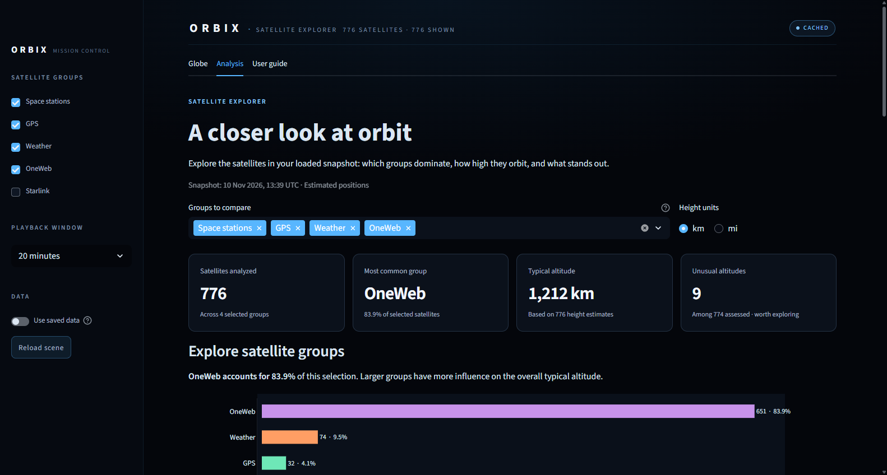
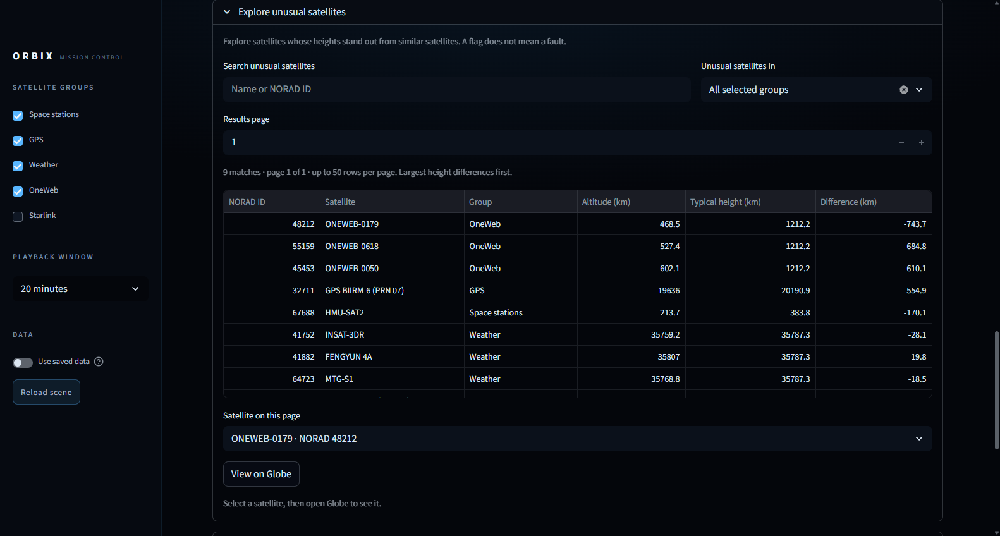

# Orbix

**Interactive 3D satellite visualization and orbital intelligence.**

Orbix is a Streamlit application that pulls *real* orbital data from CelesTrak,
propagates it with SGP4, and renders an interactive three-dimensional Earth
surrounded by satellites whose positions users can watch evolve over simulation
time. 

---

## Data source

| Item | Detail |
|---|---|
| Provider | [CelesTrak](https://celestrak.org), operated by Dr. T.S. Kelso |
| Service | General Perturbations (GP) — *Current Data* |
| Format used | `FORMAT=JSON` — CCSDS **OMM** (Orbit Mean-elements Message) keywords |
| Endpoint | `https://celestrak.org/NORAD/elements/gp.php?{QUERY}=VALUE&FORMAT=JSON` |
| Query selectors | `CATNR` (catalog number), `GROUP` (satellite group), `INTDES`, `NAME`, `SPECIAL` — uppercase only |
| Documentation | <https://celestrak.org/NORAD/documentation/gp-data-formats.php> |
| Usage policy | <https://celestrak.org/NORAD/documentation/gp-data-formats.php> (rate-limiting section) |
| Example (ISS) | <https://celestrak.org/NORAD/elements/gp.php?CATNR=25544&FORMAT=JSON> |
| Example (stations) | <https://celestrak.org/NORAD/elements/gp.php?GROUP=STATIONS&FORMAT=JSON> |

### Structure of the data

The response is a JSON **array of OMM objects** (a single-element array even for
`CATNR` queries), for example the live ISS response captured on 2026-11-04:

```json
[
  {
    "OBJECT_NAME": "ISS (ZARYA)",
    "OBJECT_ID": "1998-067A",
    "EPOCH": "2026-11-04T08:52:07.404096",
    "MEAN_MOTION": 15.49173979,
    "ECCENTRICITY": 0.0007186,
    "INCLINATION": 51.6329,
    "RA_OF_ASC_NODE": 326.3987,
    "ARG_OF_PERICENTER": 346.7494,
    "MEAN_ANOMALY": 13.3304,
    "EPHEMERIS_TYPE": 0,
    "CLASSIFICATION_TYPE": "U",
    "NORAD_CAT_ID": 25544,
    "ELEMENT_SET_NO": 999,
    "REV_AT_EPOCH": 59348,
    "BSTAR": 0.00010236,
    "MEAN_MOTION_DOT": 5.228e-5,
    "MEAN_MOTION_DDOT": 0
  }
]
```

| Field | Meaning | Unit |
|---|---|---|
| `OBJECT_NAME` | Common name (may be blank for analyst objects) | — |
| `OBJECT_ID` | International designator | `yyyy-nnnP` |
| `EPOCH` | Time the elements were fitted (ISO-8601, UTC) | UTC |
| `MEAN_MOTION` | Mean revolutions per day | rev/day |
| `ECCENTRICITY` | Orbital eccentricity | — |
| `INCLINATION` | Orbital inclination | degrees |
| `RA_OF_ASC_NODE` | Right ascension of the ascending node | degrees |
| `ARG_OF_PERICENTER` | Argument of perigee | degrees |
| `MEAN_ANOMALY` | Mean anomaly at epoch | degrees |
| `EPHEMERIS_TYPE` | Ephemeris model (`0` = SGP4) | — |
| `CLASSIFICATION_TYPE` | `U`nclassified / `C`onfidential / `S`ecret | — |
| `NORAD_CAT_ID` | Catalog number | integer |
| `ELEMENT_SET_NO` | Element set sequence number | integer |
| `REV_AT_EPOCH` | Revolution count at epoch | integer |
| `BSTAR` | Drag term | 1/Earth radii |
| `MEAN_MOTION_DOT`, `MEAN_MOTION_DDOT` | First/second mean-motion derivatives | rev/day², rev/day³ |

**CelesTrak provides orbital *elements*, not positions.** Every Cartesian
position the app displays is computed locally by propagating these elements to
the requested UTC timestamp.

### How Orbix respects the CelesTrak usage policy

* GP data is refreshed **once every 2 hours**, so the client's cache TTL is
  exactly 2 hours and a cached snapshot causes **no** network traffic.
* Since 2026-03-26 CelesTrak allows **one download per update**; a repeat request
  returns HTTP 403 "GP data has not updated since your last successful
  download". Orbix treats that as a cache hit, not an error.
* **No automatic retries** on 403/404/5xx or timeouts — repeated error requests
  get an IP firewalled.
* Only the groups Orbix actually needs are requested; bulk groups
  (`active`, Starlink) are avoided.
* Every successful payload is saved verbatim so it can be reused offline.

---

## Orbital propagation

`src/orbital/propagation.py` turns those element sets into positions with
Skyfield's SGP4 implementation, which is the corrected algorithm from Vallado,
Crawford & Hujsak, *Revisiting Spacetrack Report #3*.

One call returns the same physical position in three coordinate systems, because
mixing them up is the classic orbital-visualisation bug:

| `OrbitalState` field | Coordinate system | Rotates with Earth | Use it for |
|---|---|---|---|
| `latitude_deg`, `longitude_deg`, `altitude_km` | **WGS-84 geodetic** (`a` = 6378.137 km, `f` = 1/298.257223563) | surface | readouts, sub-satellite point |
| `ecef_km` | **ITRS / ECEF** — `x` at 0° longitude on the equator, `y` at 90°E, `z` at the north pole | **yes** | satellite markers on the Three.js globe |
| `gcrs_km` | **GCRS / ICRS** geocentric inertial | no | orbit planes, inertial geometry |
| `native_sgp4_state().teme_km` | **TEME** — SGP4's native frame | no | cross-checking only, never rendered |

Also returned: `speed_km_s` (inertial), `radius_km`, `period_minutes` (from the
mean motion), `inclination_deg`, the element `epoch`, the `element_age` at the
requested instant, and any staleness `warnings`.

```python
from datetime import datetime, timezone
from src.api.celestrak import CelestrakClient
from src.orbital import propagate

iss = CelestrakClient().fetch_by_catalog_number(25544).elements[0]
state = propagate(iss, datetime(2026, 11, 4, 9, 22, 7, tzinfo=timezone.utc))

state.latitude_deg, state.longitude_deg, state.altitude_km   # 44.751, -89.176, 426.71
state.ecef_km                                                # (-4839.62, 4768.18, 69.57)
state.gcrs_km                                                # inertial
state.speed_km_s                                             # 7.659
```

Verified behaviour:

* ISS at its 2026-11-04 epoch: **415.13 km** altitude, **7.6659 km/s**, period
  **92.95 min**, inclination **51.63°**.
* The independent `sgp4` library and a from-scratch TEME→ECEF rotation written out
  of the IAU-82 GMST expression reproduce the pipeline's Earth-fixed position to
  **0.003 m**.
* Earth-fixed and inertial vectors always share the same length, and the rotation
  between them advances at the sidereal rate (15.041°/h) — the tests assert both,
  so a frame mix-up cannot pass silently.
* Timezone-naive timestamps are **rejected** rather than guessed; elements more
  than 3.5 days from the requested time warn, and more than 30 days refuse.

```bash
python scripts/verify_propagation.py                  # ISS at its element epoch
python scripts/verify_propagation.py --when now --offsets 0,15,30,45
python scripts/verify_propagation.py --group STATIONS --limit 4
```

No network access is needed for propagation: Skyfield's built-in Earth-orientation
tables are used by default (the IERS `finals2000A.all` variant differs by 72 m and
is opt-in), and no JPL ephemeris download is required.

---

## Setup

Requires **Python 3.11+** (verified on 3.13.5).

```bash
git clone <repository-url>
cd Orbix

python -m venv .venv
# Windows
.venv\Scripts\activate
# macOS / Linux
source .venv/bin/activate

pip install -r requirements.txt
```

No API keys or credentials are required: the CelesTrak GP API is public. Orbix
does not read secrets from `.env` for data access and never hardcodes keys.

---

## Constellation explorer

| Group | CelesTrak id | Objects |
|---|---|---|
| Space stations | `stations` | 20 |
| GPS | `gps-ops` | 32 |
| Weather | `weather` | 74 |
| OneWeb | `oneweb` | 651 |
| Starlink | `starlink` | 11,181 |
| **Unique total** | de-duplicated by NORAD ID | **11,958** |

Groups are loaded **once per group** (never per satellite), de-duplicated by NORAD
catalog ID, and an object that appears in several groups keeps every membership.
A group that fails is reported as *failed* in the sidebar with its error; Orbix never
substitutes one group for another. Starlink is off by default because it is ~10× the
rest of the catalogue.

### Rendering

All satellites are drawn as one `THREE.Points` geometry with a small custom shader:
a solid core plus a soft halo, category colour per vertex, size clamped so markers stay
sensible at any zoom, and additive blending kept below 1.0 so colours do not clip to
white. That is **one draw call** for the whole catalogue.

globe.gl's own point layer was measured first and could not animate the full set: at
11,958 points it rendered 189 fps static but only **19.7 fps when animated**. The
batched layer does **52–78 fps** animating the same set (software WebGL, so a real GPU
is faster). The measurements are in `docs/technical_decisions.md` (D17).

### Selection and filtering

* **Hover** ray-casts against the point cloud (throttled to ~22 Hz) and shows name,
  NORAD ID, constellation, altitude and inclination.
* **Click** selects by NORAD ID: the marker grows and turns white, its orbit trail is
  drawn for one full period, the on-globe panel updates, and the selection is sent to
  Python through the component bridge so the Streamlit panel updates too. Selection is
  kept in `st.session_state`, so it survives ordinary interactions.
* **Filtering** happens inside the iframe against the real sidebar checkboxes: no data
  is re-requested and no Streamlit rerun occurs. The HUD shows
  `visible / total` plus live fps and per-frame update cost.

### Simulation playback

The playback window (10/20/45/90 min) is sampled once in Python and **starts at the
instant the scene loads**, running forward from there: Orbix plays orbital
*predictions*, it never rewinds behind the load instant. Playback runs
entirely in the browser: Play/Pause, 10×–900× speed, Reset, and a scrub slider, with
the simulation UTC clock shown in the bar.

Positions are **linearly interpolated between SGP4 keyframes**, so different orbital
periods, inclinations and planes are all respected — this is not a shared rotation.

Sampling density is chosen from two constraints and the resulting error is always
displayed:

| Constraint | Effect |
|---|---|
| Accuracy | sample finely enough that the chord error stays ≤ 1 km |
| Payload budget | coarsen if `satellites × keyframes` would exceed ~2 MB of base64 |

The playback bar reads, for example::

    ▶ Play   ⟲ Reset   60×   [=======|==========]   2026-11-04 21:45:12Z
    ● start 2026-11-04 21:25:12Z · range 0 → +20 min · orbital prediction, not live tracking
    41 keyframes over 20 min (every 0.5 min); worst-case interpolation error ≈ 1.0 km

so the window's start, the current simulation instant and the playable range are all
visible at once.

For the 777-satellite default that is 41 keyframes over 20 min (every 30 s, error
≈ 1.0 km). For all 11,958 satellites it is 10 keyframes over 20 min (every 2.2 min,
error ≈ 19 km) — the HUD and the Streamlit panel both state the number, so the
trade-off is never silent. Filtering to fewer constellations restores fine sampling.

Re-running the whole app (e.g. after a selection) does **not** re-ship the keyframes:
the payload carries a scene fingerprint and omits them when the scene is unchanged,
which is why a light rerun is ~97 KB instead of ~596 KB.

---

From the repository root, with dependencies installed (see Setup above):

```bash
python -m streamlit run app.py
```

Using `python -m streamlit` rather than the bare `streamlit` command matters: when
`pip` installs packages into the per-user directory, the `streamlit.exe` launcher
lands in `%APPDATA%\Python\Python3xx\Scripts`, which is often **not** on `PATH`. Running
it through the interpreter always works. If you prefer the short command, add that
folder to `PATH` once:

```powershell
$scripts = "$env:APPDATA\Python\Python313\Scripts"
[Environment]::SetEnvironmentVariable(
    "Path", [Environment]::GetEnvironmentVariable("Path", "User") + ";$scripts", "User")
# then open a new terminal and check:
streamlit --version
```

Your browser opens <http://localhost:8501> automatically. The first load:

1. reads the ISS element set through the CelesTrak client (cache → network →
   snapshot, in that order),
2. propagates the current state and 120 further samples across one orbital period,
3. hands that scene to the Globe.gl component, which draws it.

No API key is needed, and if the machine is offline the committed snapshot is used
(the header chip then reads `SNAPSHOT` rather than `CACHED`/`LIVE`).

**Controls:** drag to orbit, scroll to zoom, hover the satellite for a readout,
click it to send a selection event back to Python. Use the sidebar to switch on
offline mode, force a CelesTrak re-download, or refresh the scene.

Useful extras:

```bash
# verify the 3D component really renders, in a headless browser (needs selenium)
python scripts/smoke_test_ui.py --screenshot docs/screenshots/step-d-globe.png

# verify the data layer and the propagation layer from the command line
python scripts/verify_celestrak_api.py
python scripts/verify_propagation.py --offsets 0,30,45
```

### Common problems

| Symptom | Cause and fix |
|---|---|
| `streamlit : The term 'streamlit' is not recognized...` | The `streamlit.exe` launcher is installed but its folder is not on `PATH`. Use `python -m streamlit run app.py`, or add `%APPDATA%\Python\Python313\Scripts` to `PATH` (see above). |
| `ModuleNotFoundError: No module named 'streamlit'` | Wrong interpreter: the packages are installed for a different Python, or the virtualenv is not activated. Run `python -m pip install -r requirements.txt`. |
| `Could not load orbital data (CelestrakNetworkError)` | No network and no snapshot. Turn off offline mode to retry, or fetch once while connected. |
| Header shows `CACHED` when you expected `LIVE` | Working as intended: the local cache is authoritative for 2 hours, matching CelesTrak's refresh cadence. Tick "Force CelesTrak re-download" to bypass it. |
| CelesTrak answers HTTP 403 "not updated" | CelesTrak allows one download per 2-hour update. Orbix reports it as a cache hit, not an error. |
| Globe area is blank/black | The WebGL context or the vendored `globe.gl.min.js` did not load; check the browser console. Everything else on the page should still work. |
| Satellite looks stationary between visits | The scene is cached for 60 s, and ISS elements are typically hours old. Check "element age" in the panel — this is not a live tracking view. |

---

## How the globe works

```text
CelesTrak OMM/JSON  ──►  src/api/celestrak.py      (fetch, validate, cache, snapshot)
        │
        ▼
GpElement ──► src/orbital/propagation.py  (SGP4 via Skyfield)
        │        ├─ WGS-84 geodetic lat/lon/altitude
        │        ├─ ITRS/ECEF Cartesian   (Earth-fixed)
        │        └─ GCRS Cartesian        (inertial, for checks)
        ▼
src/ui/presentation.py  (Scene: state + 121-sample track + freshness + panel facts)
        │
        ▼
components/globe/payload.py  (JSON contract: degrees + altitude as a fraction of
        │                     the globe radius - no maths left for the browser)
        ▼
components/globe/frontend/orbix-globe.js  (Globe.gl draws it)
```

### Python → JavaScript

The globe is a **real Streamlit custom component**, not an injected HTML blob:
`components/globe/__init__.py` calls `components.declare_component()` on the static
directory `components/globe/frontend`, so Streamlit serves those files from
`/component/components.globe.orbix_globe/`.

The front-end speaks Streamlit's component protocol directly (version 1) through a
~40-line bridge in `orbix-globe.js`:

| Direction | Message | Purpose |
|---|---|---|
| JS → Python | `streamlit:componentReady` | handshake on load |
| JS → Python | `streamlit:setFrameHeight` | keeps the iframe the right height |
| Python → JS | `streamlit:render` | delivers `{payload, height}` on every rerun |
| JS → Python | `streamlit:setComponentValue` | returns a value, e.g. a marker click |

That last message is the two-way channel Step E builds on: clicking the satellite
currently sends `{"event": "select", "norad_id": 25544, ...}` back, and `app.py`
shows it under the globe. Camera movement happens entirely inside the iframe and
never triggers a Python rerun.

### Turning orbital coordinates into pixels

| Step | What happens |
|---|---|
| Frame | `propagation.py` gives latitude/longitude in the **Earth-fixed** ITRS frame - the same frame the globe mesh uses. |
| Position | Globe.gl is driven with `.pointLat/.pointLng` in degrees and `.pointAltitude` as a **fraction of the globe radius**; `payload.py` converts `altitude_km / 6371.0088`. The ISS therefore renders at ≈ 0.0667. |
| Marker size | `.pointRadius` is in **angular degrees** (not km and not radii). The default 0.9° is deliberately larger than a to-scale satellite; only the *size* is exaggerated, never the position or altitude. |
| Visibility | A translucent halo, a surface radar ring and a label make a 425 km object findable; a thin leader line drops from the marker to its sub-satellite point to keep the altitude honest. |
| Track | 121 Earth-fixed samples across the next orbital period, so the curve is drawn in the same frame as the rotating Earth. It is *not* an inertial orbit plane, and it drifts west each pass as the Earth turns - which is correct, and is asserted by a test (336.5° of longitude advance per 92.95 min orbit instead of 360°). |

### Textures and assets

Earth imagery is NASA's Blue Marble (public domain) with a NASA-derived topology
bump map, and Globe.gl 2.34.4 is pinned. All of it is **committed** under
`components/globe/frontend/` (~3.2 MB) rather than fetched from a CDN at runtime, so
a flaky network cannot leave the demo with an empty box. Provenance and licences are
recorded in `components/globe/frontend/assets/README.md`.

---


## Repository layout

```text
Orbix/
├── app.py                          # Streamlit entry point (Step D)
├── src/
│   ├── api/celestrak.py            # CelesTrak GP/OMM client, cache, snapshots
│   ├── orbital/propagation.py      # SGP4 -> geodetic/ECEF/GCRS positions
│   ├── ui/presentation.py          # Scene assembly + info-panel facts (no Streamlit)
│   ├── ui/loading.py              # st.cache_data wrapper for the scene
│   ├── ui/theme.py                 # page config + dark aerospace CSS
│   └── data/processing.py          # element cleaning / tabular prep (Phase 2)
├── components/globe/
│   ├── __init__.py                 # declare_component + public API
│   ├── payload.py                  # Python -> JS scene contract (tested)
│   └── frontend/                   # static assets served to the iframe
│       ├── index.html
│       ├── orbix-globe.js          # Globe.gl scene + Streamlit protocol bridge
│       ├── style.css
│       ├── assets/                 # NASA Blue Marble + topology (licences inside)
│       └── vendor/globe.gl.min.js  # pinned Globe.gl 2.34.4
├── scripts/
│   ├── verify_celestrak_api.py     # Step B acceptance check (CLI)
│   ├── verify_propagation.py       # Step C acceptance check (CLI)
│   └── smoke_test_ui.py            # Step D headless-browser check (optional)
├── tests/                          # pytest suite + real-data fixtures
├── data/snapshots/                 # saved CelesTrak payloads + manifest.json
├── docs/
│   ├── assignment_requirements.md  # requirement → feature mapping
│   ├── technical_decisions.md      # decisions, evidence, limitations
│   └── screenshots/                # application screenshots for the report
├── .streamlit/config.toml          # dark theme, usage stats off
├── requirements.txt
├── requirements-dev.txt
├── pytest.ini
└── README.md
```

---

## Verifying the data pipeline

The Step B acceptance check performs one CelesTrak query, validates the OMM
structure, saves a snapshot, and prints a verification summary:

```bash
python scripts/verify_celestrak_api.py                 # ISS (NORAD 25544)
python scripts/verify_celestrak_api.py --show-raw      # + raw OMM record
python scripts/verify_celestrak_api.py --group STATIONS
python scripts/verify_celestrak_api.py --offline       # snapshots only
python scripts/verify_celestrak_api.py --refresh       # ignore the 2h cache
```

Exit code `0` means real data was retrieved, validated and stored. Non-zero means
the request failed and nothing was fabricated.

---

## Tests

```bash
pip install -r requirements-dev.txt
python -m pytest
```

The suite is hermetic: HTTP is replaced by injected fakes, orbital fixtures are
real captured CelesTrak payloads, and the clock is controllable so cache-expiry
behaviour is deterministic. Propagation tests run entirely offline against
Skyfield's built-in time tables.

Expected result: **168 passed**.

The globe itself cannot be verified from Python, so `scripts/smoke_test_ui.py`
drives it in a real headless browser and asserts that markers, label, rings and
track reached the renderer with no console errors (it needs `selenium` and a Chrome
or Edge install; see `requirements-dev.txt`).

### Analysis tab (Phase 2)

`src/analysis/` turns the loaded scene into one documented DataFrame and computes the
statistics the Analysis tab presents. It imports no Streamlit and fetches nothing: the tab
and the globe always describe the same snapshot, elements and anchor instant.

| Module | Contents |
|---|---|
| `provenance.py` | Registry of every column: provenance class (identity / grouping / element / derived / propagated), unit and source |
| `frame.py` | `catalog_frame(scene)` -> one row per object; `classify_regime()` (LEO/MEO/GEO/HEO); `validate_frame()` enforces the registry |
| `stats.py` | `describe`, `missing_report`, `freshness`, `composition`, `regime_counts`, `add_stratum`, `outliers`, `correlation_matrix`, `per_group_correlations`, `pooled_vs_within` |
| `figures.py` | Plotly builders for the five sections, plus `selection_norad_ids()` (chart click -> NORAD ids) |
| `overview.py` | Dashboard summaries, altitude display bands and computed discoveries; reuses existing statistics |
| `src/ui/analysis_tab.py` | The tab itself: controls, charts, tables and the methodological captions |



The Analysis tab opens with four summary cards: satellites analyzed, most common group,
typical altitude, and unusual-altitude count. A single **Groups to compare** selection
drives the entire report. Group counts use readable names and the globe's colours;
an altitude comparison shows each group's median, middle half and full range on a linear
axis. Switch between kilometres and miles, or choose **Near Earth** (below 2,000 km,
the default), **Higher Orbits** (2,000 km and above), or **All Satellites**. These display
bands describe propagated height at the snapshot time, not the element-derived orbital
regimes. The chart reports excluded/missing counts and leaves summary statistics unchanged.

Computed discoveries identify the farthest selected satellite, the widest group altitude
range, and statistically unusual altitudes. Overview flags reuse the existing IQR (1.5)
and modified z-score (3.5) rules **within constellation and orbital regime**. Strata with
fewer than four valid estimates are unassessed. Flags never imply danger or remove rows.

**Data quality & methodology** expands to reveal all original analyses: distributions and
descriptive statistics, freshness and missing-data audit, configurable outlier diagnostics,
pooled-vs-within correlations, the selectable orbit map, full data and column provenance.
Advanced outlier controls are exploratory and do not change the overview's fixed count.
Technical diagnostics retain their documented scientific units.

Discovery cards link directly to satellite selection, group highlighting and an
**Explore unusual satellites** section. Search by name or NORAD ID, filter by group,
and browse 50-row pages showing altitude, comparison-group median, signed difference
and flag reasons. **View on Globe** selects the stable NORAD ID in the same state the
globe uses. Open the Globe tab to see the selected marker, information panel and orbit
trail, with camera and playback preserved. Box/lasso selection remains available in
the advanced orbit map. Clear highlights
explicitly; changing groups removes highlights outside the selection. Satellites without
propagated positions remain in the data audit but cannot be highlighted on the globe.
Analysis describes the starting snapshot even while the globe's playback advances.

The scene remains pinned while you explore, even after the shared cache expires.
**Reload scene** or changing the sidebar data scope loads a new scene. Statistical
results and selected orbit trails are cached, so ordinary Analysis controls reuse data.

An independent audit reproduced the exact outlier IDs: 1,497 unique flags among 11,981
assessed satellites at 2026-11-05 23:00 UTC, including 1,491 Starlink satellites. The high
count reflects distinct altitude populations within Starlink's LEO group; the rules
were mathematically correct and their thresholds were preserved. Counts vary by snapshot
time. See the [Phase 2 report](docs/phase2_interactions.md) for the audit, limitations,
changed-file list, verification and the command to reproduce it.

No LLM service exists yet in this repository: discoveries are deterministic summaries of
computed statistics. The assignment's LLM integration remains Phase 3 work.

Run `python scripts/smoke_test_ui.py --offline --analysis-screenshot docs/screenshots/analysis-redesign.png`
to verify the dashboard, disclosed diagnostics and group-to-globe highlight round trip
against saved data, including 1600 px and 1366 px viewport captures.



The distinction the registry enforces is not decorative: `semi_major_axis_km - 6378.137` is
**681 km wrong** as an altitude for `FREGAT DEB` (e = 0.093) and right to 7.5 km for
near-circular orbits, so both columns exist and neither stands in for the other. See
`docs/technical_decisions.md` D21-D23 for the statistical choices (Spearman, no p-values, no
imputation, MAD-degeneracy handling, stratification before interpretation) and for why a
large "outlier" share is reported as *heterogeneity* rather than as contaminated data.

---

## Roadmap

| Step | Scope | Status |
|---|---|---|
| A | Repository inspection and environment audit | done |
| B | CelesTrak API client, snapshots, tests | **done** |
| C | Skyfield SGP4 propagation: geodetic/ECEF/GCRS, reference cross-check, tests | **done** |
| D | Streamlit + interactive Globe.gl Earth, ISS marker, orbit track, info panel | **done** |
| E | Time slider/playback, richer selection, focus controls, freshness badge | next |
| F | GPS-OPS and a bounded Starlink subset, rendering performance | pending |
| Phase 2 | EDA: statistics, correlations, missing data, outliers, in-app insights | **done** - Analysis tab with regime scatter, distributions, freshness/missing audit, outlier diagnostics and pooled-vs-within correlations |
| Phase 3 | LLM-grounded orbital analysis and natural-language explanations | deferred |

---

## Data integrity statement

Orbix will not display invented orbital data. If CelesTrak is unreachable and no
saved snapshot exists, the application reports the failure instead of drawing
satellites at made-up positions. Every rendered position is derived from a real
OMM element set whose retrieval time and epoch are shown in the interface.

